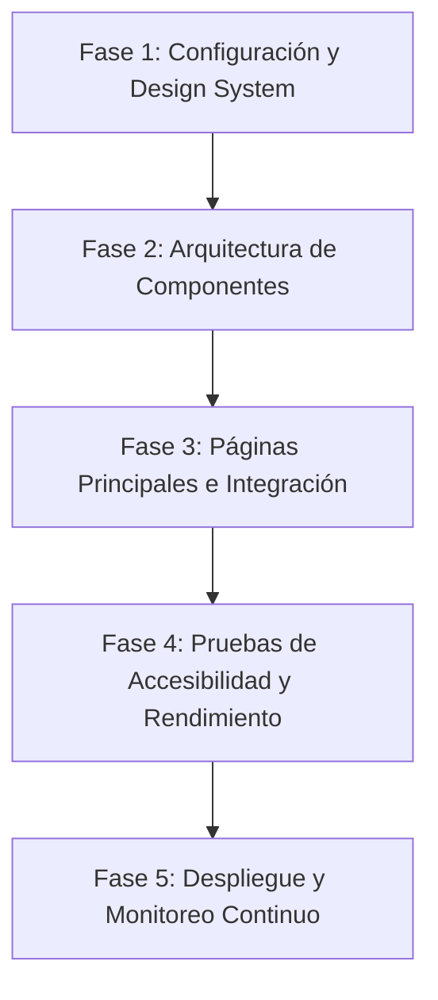

# Plan de Desarrollo Frontend: Portal Informativo y Educativo Abierto

## 1. Visión General del Proyecto

Este plan define la estrategia de arquitectura, diseño e implementación para el desarrollo de un portal frontend moderno, escalable e hiperaccesible. La solución integra:
* **La claridad institucional y el diseño nórdico minimalista** de [Government.se](https://www.government.se/) (estructuras claras, alto contraste, jerarquía de contenido gubernamental).
* **La capacidad de descubrimiento y gestión de recursos** de [OER Commons](https://oercommons.org/) (metadatos enriquecidos, sistemas de búsqueda avanzada y colecciones).
* **Cumplimiento estricto de accesibilidad WCAG 2.1 Nivel AA**.

---

## 2. Arquitectura de UI/UX e Inspiración Visual

### 2.1 Principios Inspirados en Government.se
* **Diseño sin distracciones:** Colores sobrios (azul institucional, gris neutro y blanco), tipografía altamente legible y ausencia de animaciones innecesarias.
* **Jerarquía clara de la información:** Organización por categorías, temas estratégicos y publicaciones ordenadas cronológica o temáticamente.
* **Enfoque *Keyboard-First*:** Todos los componentes, menús desplegables e hipervínculos deben ser 100% funcionales mediante el teclado con focos visuales bien definidos (`outline: 3px solid #005A9C`).

### 2.2 Principios Inspirados en OER Commons
* **Motor de Búsqueda y Filtros Facetados:** Interfaz para filtrar recursos por materia, formato de medios, tipo de licencia (Creative Commons) y nivel educativo.
* **Componentes de Contribuir / Compartir:** Formularios accesibles para cargar o remezclar contenido (*Open Author*).
* **Fichas de Recursos con Metadatos Enriquecidos:** Renderizado claro de licencias, autores, descripciones largas y formatos disponibles.

---

## 3. Stack Tecnológico Frontend

| Capa | Tecnología Seleccionada | Justificación |
| :--- | :--- | :--- |
| **Framework Base** | Next.js (React) / Nuxt.js (Vue) | Server-Side Rendering (SSR) y Static Site Generation (SSG) esenciales para SEO y rendimiento. |
| **Estilos** | Tailwind CSS / CSS Modules | Control preciso del contraste de colores, espaciados dinámicos y clases responsivas. |
| **Librería de Componentes** | Radix UI / Headless UI | Componentes sin estilo sin marca (*unstyled*), con soporte nativo e incondicional de ARIA y comportamiento de teclado WCAG. |
| **Validación de Formularios** | React Hook Form + Zod | Manejo eficiente de errores con mensajes accesibles para lectores de pantalla. |
| **Auditoría CI/CD** | Axe-core + Lighthouse | Pruebas automatizadas de accesibilidad en cada integración de código. |

---

## 4. Estrategia de Cumplimiento WCAG 2.1 Nivel AA

### 4.1 Perceptible
* **Relación de Contraste (Criterio 1.4.3 y 1.4.11):**
  * Texto normal: Mínimo **4.5:1**.
  * Texto grande e íconos interactivos: Mínimo **3:1**.
  * Selector global de "Alto Contraste" para usuarios con visión reducida.
* **Reflujo y Adaptabilidad (Criterio 1.4.10):**
  * Soporte de ancho fluido hasta **320px CSS** sin desplazamiento horizontal.
  * Uso de unidades relativas (`rem`, `em`, `%`, `vw`/`vh`) para respetar las preferencias de zoom del navegador (hasta 200%).

### 4.2 Operable
* **Enlace de Salto (*Skip Navigation*) (Criterio 2.4.1):**
  * Primer elemento enfocable que permite ir directamente al contenido principal (`#main-content`).
* **Navegación por Teclado e Indicador de Foco (Criterio 2.4.7):**
  * Eliminación del `outline: none` salvo que se reemplace por un indicador personalizado visible de alto contraste.
* **Cancelación del Puntero y Gestos (Criterio 2.5.1 y 2.5.2):**
  * Acciones activadas al soltar el clic/toque (*up-event*). Sin dependencia de gestos complejos (deslizar o pellizcar) para operar funciones clave.

### 4.3 Comprensible
* **Identificación del Idioma (Criterio 3.1.2):**
  * Etiquetas `<html lang="es">` globales y marcado explícito (`...`) para términos en otros idiomas.
* **Sugerencia y Prevención de Errores (Criterio 3.3.3 y 3.3.4):**
  * Formularios con mensajes de error asociados mediante `aria-describedby` y estados claramente anunciados.

### 4.4 Robusto
* **Mensajes de Estado Asíncronos (Criterio 4.1.3):**
  * Uso de `aria-live="polite"` en alertas, resultados de búsqueda y notificaciones del sistema para que los lectores de pantalla informen los cambios sin robar el foco.

---

## 5. Fases de Ejecución del Proyecto

### Fase 1: Fundamentos y Sistema de Diseño Accesible
* Configurar tokens de diseño (colores con contraste validado, tipografía escalable, espaciados W3C).
* Configurar linters de accesibilidad (`eslint-plugin-jsx-a11y`).
* Implementar layouts base con estructuras HTML5 semánticas (`<header>`, `<nav>`, `<main>`, `<aside>`, `<footer>`).

### Fase 2: Desarrollo de Componentes Clave
1. **Header e Integración de Búsqueda (Estilo Government.se):**
   * Menú global accesible por teclado con soporte para `aria-expanded` y `aria-haspopup`.
   * Barra de búsqueda con autocompletado y anuncios mediante `aria-live`.
2. **Sistema de Búsqueda Avanzada y Filtros (Estilo OER Commons):**
   * Panel lateral de filtros facetados con casillas de verificación accesibles.
   * Lista de resultados con tarjetas de recursos (*Resource Cards*) etiquetadas semánticamente.
3. **Formularios de Contribución de Recursos:**
   * Validaciones en tiempo real accesibles y manejo claro de mensajes de error.

### Fase 3: Integración de Vistas y SSR
* Página de Inicio / Portal Principal (Líneas estratégicas, avisos institucionales).
* Vista de Resultados de Búsqueda y Catálogo.
* Ficha Detallada del Recurso / Artículo (Licencias CC, descripciones largas, descripciones de imágenes/transcripciones).

### Fase 4: Pruebas, Auditoría y Calidad
* **Pruebas Automatizadas:** Ejecución de suites `Axe-core` y `Lighthouse CI`.
* **Pruebas Manuales con Teclado:** Verificación de orden de foco, trampas de foco en modales y atajos.
* **Pruebas con Tecnologías de Asistencia:** Evaluación con lectores de pantalla (NVDA, VoiceOver y TalkBack).

---

## 6. Lista de Verificación de Entregables (Checklist)

- [ ] HTML5 100% Semántico (sin `
` interactivos no etiquetados).
- [ ] Implementación de enlace de salto *"Ir al contenido principal"*.
- [ ] Paleta de colores ajustada a la matriz de contraste WCAG AA.
- [ ] Todos los elementos interactivos cuentan con `focus-visible`.
- [ ] Textos alternativos (`alt`) explicativos para imágenes informativas y `alt=""` para imágenes decorativas.
- [ ] Formularios integrados con `aria-describedby` y `aria-invalid`.
- [ ] Modales con bloqueo de foco (*focus trap*) y tecla `Esc` para cerrar.
- [ ] Puntuación > 95 en la categoría de Accesibilidad de Google Lighthouse.