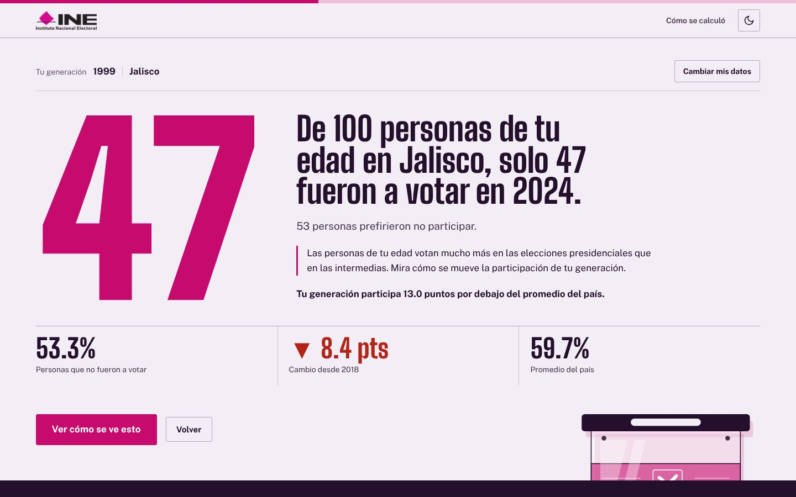
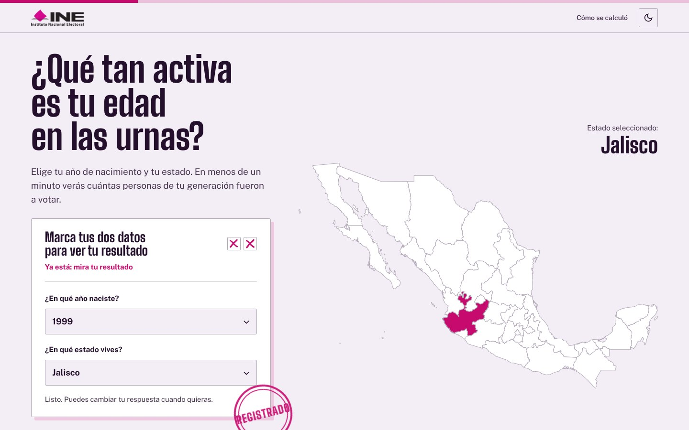
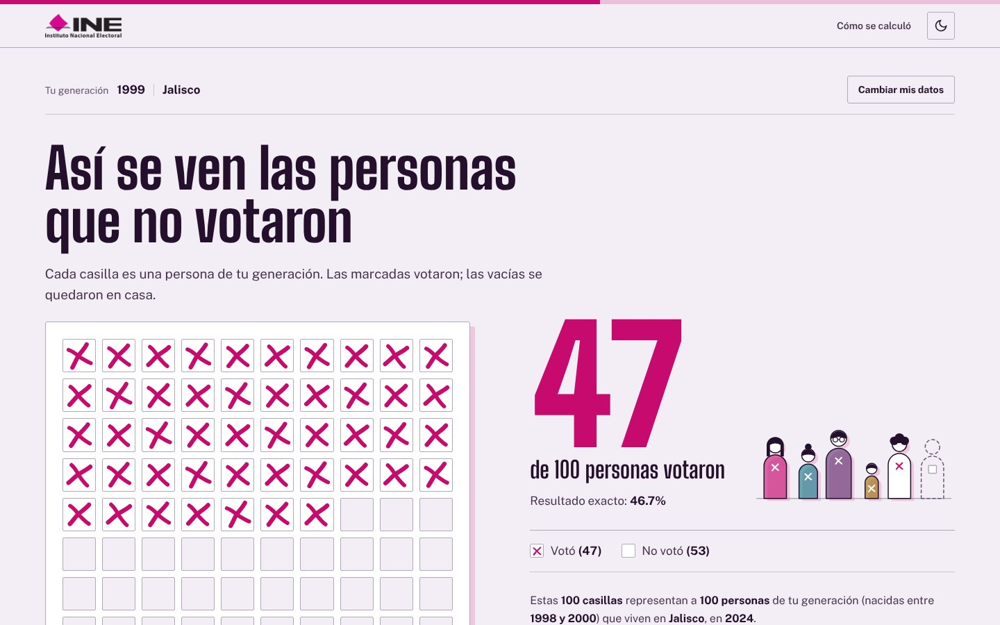
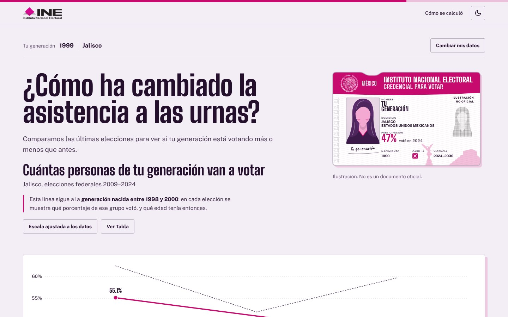
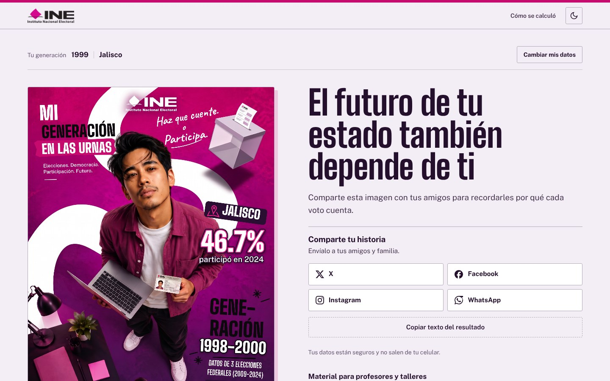
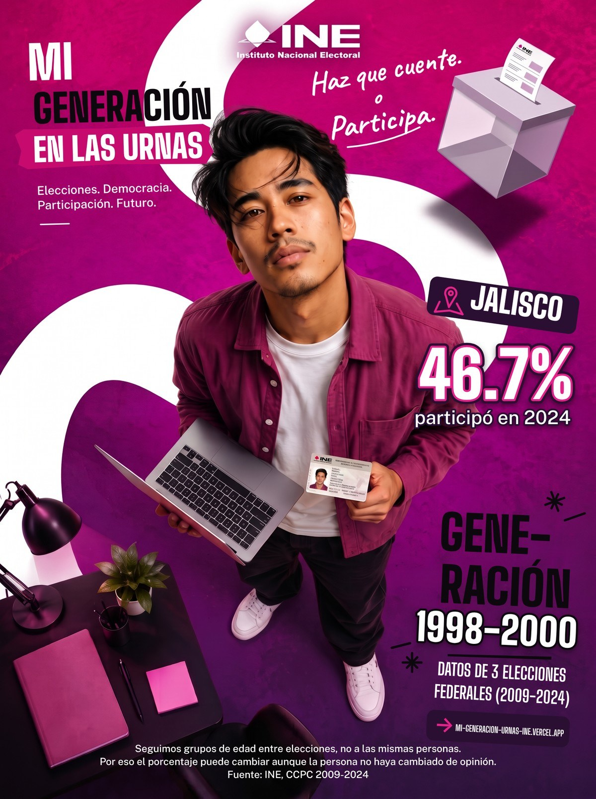

 
<picture>
  <source media="(prefers-color-scheme: dark)" srcset="assets/images/logo-oscuro.png">
  <source media="(prefers-color-scheme: light)" srcset="assets/images/logo-claro.png">
  
</picture>

<b>Descubre la historia de tu generación en las urnas</b>

 

 

<a href="https://mi-generacion-urnas-ine.vercel.app/"><b>Abrir el sitio →</b></a>

 

---

 

   

  

  

  

Datos: INE, Conteos Censales de Proceso Constitucional (CCPC), elecciones federales 2009 a 2024

